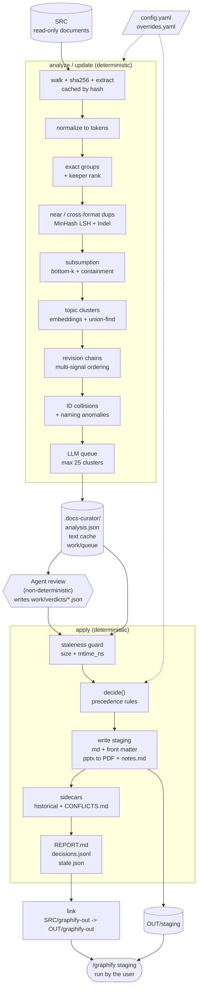

# How docs-curator works

The script is `docs/docs-curator/scripts/curate.py`, a single-file CLI. It is deterministic everywhere except one step. That step is the semantic review, where the agent (Claude) reads queued clusters and writes verdict JSON files. The script never calls an LLM itself.

## 1. Architecture



The OUT layout is:
- `text/v1/<sha>.md` or `.err`: the extraction cache.
- `analysis.json`: the full analysis.
- `work/queue` and `work/verdicts`: the review hand-off.
- `state.json`, `changes.json`, `decisions.jsonl`, `REPORT.md`, and `pdf/<sha>.pdf`.
- `staging/` and `graphify-out/`.

`check_paths` forbids OUT inside SRC and SRC inside OUT. The default OUT is `~/curated/<basename>`.

## 2. `analyze`

### 2.1 Inventory and extraction
- `walk` skips symlinks, non-files, and the directories `.git`, `node_modules`, `__pycache__` and `graphify-out`. It visits entries in sorted order, which keeps results reproducible.
- Each file gets a record with its sha256, size, `mtime_ns` and format.
- Unsupported extensions get the status `not_ingestible`.
- Extraction is cached by content hash, in `text/v{EXTRACT_VERSION}/<sha>.md`. A failure is cached as `<sha>.err`, so a bad file is not retried on every run. Bumping `EXTRACT_VERSION` invalidates the cache.
- `.md` and `.txt` are decoded as utf-8-sig, then cp1252, then latin-1.
- Other formats go through markitdown. Before that, the script checks `zipfile.is_zipfile` for Office files and the `%PDF` header for PDFs. This check is there because markitdown silently falls back to plain text on a corrupt container.

### 2.2 Normalization
`normalize` produces the token stream used by every later comparison. It strips pptx speaker notes, HTML comments, and lines like "Page 3 of 9" or "Slide 4". It then lowercases the text and extracts `[a-z0-9]+` tokens. A file with zero tokens becomes `text_free`. It is still staged, with an empty body, and there is no OCR.

### 2.3 Exact duplicates and keeper selection
Files are grouped by sha256. The representative of each group is `min(rank_key)`:

```
(FORMAT_RANK, -token_count, -descriptive_score, filename_marker_count, path)
```

- Format rank prefers structured and editable formats: md < docx < pptx < xlsx < pdf < txt.
- Token count prefers the fuller extraction.
- `descriptive_score` counts the filename words (4 or more letters, not stopwords) that appear in the first 300 tokens of the text. It prefers `vendor-security-policy.docx` over `doc1.docx`, and can be turned off with `keeper_prefers_descriptive_name`.
- The marker count prefers filenames without `final`, `copy` and similar words.
- The path is the final tie-break, which keeps the choice stable.

### 2.4 Near and cross-format duplicates
These are compared only between representatives that have at least 5 tokens.

1. **Shingling:** each document becomes a set of word bigrams. Each bigram is hashed to 64 bits with blake2b.
2. **Candidate generation:** a MinHash with 128 permutations and `seed=1` feeds an LSH index with threshold 0.35. This avoids an O(n²) comparison over all pairs.
3. **Confirmation:** the candidate pairs are scored with `rapidfuzz.Indel.normalized_similarity` on the token sequences. This is an LCS-based, order-sensitive ratio. The default cutoff is 0.90.
4. **Large documents:** if either document has more than 50,000 tokens, it falls back to a Dice coefficient over token multisets. That score is order-insensitive and reads lower, so it errs toward not matching.
5. **Edge kind:** an edge is `cross` if the two formats differ, and `near` otherwise.
6. **Grouping:** edges are merged into groups with union-find, which is transitive. The keeper is again `min(rank_key)`.

Only cross-format losers are removed from the "alive" set at this stage. Same-format near duplicates stay alive, so the later stages can still see them. That matters because `near_duplicate_action: flag` is the default.

### 2.5 Subsumption
This detects a short document that is mostly contained in a longer one, such as an excerpt or a summary.

- An inverted index maps each shingle hash to the documents that contain it.
- For each document A with at least 20 tokens, the script takes a deterministic sample of its 64 smallest hashes. This is a bottom-k sketch. Each other document B gets one vote per sampled hash it contains.
- B passes the cheap filter if it holds at least 80% of the sample and A is at most 80% of B's length (`1 - subsumed_min_length_ratio`).
- The exact check is containment, `|S(A) ∩ S(B)| / |S(A)|`. It must be at least 0.95.
- Subsumed documents are only ever flagged, never excluded automatically.

### 2.6 Topic clustering
- Each alive document is represented by its first 400 words, with comments stripped.
- The embeddings are fastembed `BAAI/bge-small-en-v1.5`, or TF-IDF with sublinear tf and English stopwords. They are L2-normalized, so the dot product equals the cosine.
- The similarity cut is `max(floor, mean + z·std)` over the upper triangle of the similarity matrix. The default `z` is 1.0, and the floors are 0.78 for fastembed and 0.25 for TF-IDF. Because it is corpus-relative, the cut adapts to how homogeneous the corpus is.
- Pairs at or above the cut are merged with union-find. This is single linkage, so clusters can chain. Clusters of size 2 or more are kept.
- The cluster ID is `sha256(sorted member shas)[:16]`. It is stable under renames or moves, and it changes when membership or content changes. That is what makes verdict caching correct: a stale verdict stops matching its cluster.
- If fastembed can't load its model, for example when offline, the run aborts with a hint to switch to TF-IDF. It does not fall back silently.

### 2.7 Revision chains
Candidates are alive documents in the same cluster that share a normalized filename stem. The grouping key is `(directory, stem, cluster_id)`, or an empty directory when `revision_chain_scope: corpus`.

`parse_name` tokenizes the stem and extracts markers from anywhere in it:
- Version words: `v2`, `ver1.3`, `rev4`, `version 2`.
- Strict markers: `copy of`, a trailing `copy`, `updated`, `revised`.
- Ambiguous markers: `final`, `latest` and `current` score +1, and `draft` scores −1.

The remaining tokens form the stem.

`analyze_chain` builds independent oldest-to-newest orderings, one from each signal:
- the filename (version tuple, then strict count);
- the ambiguous markers;
- the version line in the text (`Version 2.1`, from the first 60 lines);
- the date line in the text (`Last updated: 2024-03-01`);
- the docx/pptx/xlsx `dcterms:modified` metadata;
- the file mtime.

`_order` returns `None` if any member lacks the signal or if two members tie. A signal that can't fully order the chain abstains rather than guessing.

The voting rules are:
- Ambiguous markers vote only if they agree with a text-derived ordering. Otherwise they are recorded as `ambiguous_ignored`.
- mtime never votes when any other signal exists, because copying and syncing rewrite it. It is used as a fallback, and its agreement is reported as `mtime_agrees`.
- The chosen order is the highest-priority voting signal. The others are tallied as `agreeing` or `contradicting`.
- A chain is `deterministic` if at least two signals agree and none contradict.

### 2.8 Identifier collisions
These are cases where `PROJ-123` refers to different things in different files. Patterns are configurable, and the default is `\b[A-Z][A-Z0-9]{1,9}-\d{1,6}\b`. `id_sites` extracts three kinds of site:
- the filename stem (underscores become spaces, because `\b` doesn't fire next to `_`);
- Markdown headings that start with an ID;
- table rows where the key column's header is in `identifier_title_headers` (id, ticket, key, ref, number).

Each site yields an ID and its adjacent title text. `find_collisions` reports an ID that appears in at least two files where some pair of titles has word-set Jaccard below 0.2. It runs on representatives only.

### 2.9 Naming anomalies
Two cases are flagged:
- An exact-hash group whose members have different normalized stems.
- A near-duplicate pair with similarity at or above 0.999 and different stems. These are "same content filed under conflicting names."

### 2.10 LLM queue
Clusters are sorted by size descending, then ID. Any cluster that already has a verdict file is skipped. At most `max_llm_clusters_per_run` (25) are queued. Each queue item contains:
- the members, with text-cache paths, `also_at` exact copies, and token counts;
- each member's revision signals;
- the relevant chains and near-duplicate pairs;
- `read_words` (6000), a read budget for the reviewing agent.

Deferred clusters show up in the report as pending.

## 3. `update`
This is a diff wrapper around `analyze`. It snapshots the old `path → sha` map and re-runs `analyze`. Cached extractions make this cheap. It then computes added, modified and removed files. It lists the clusters that contain a new or modified file, the currently queued clusters, and "stale verdicts" that match no current cluster. The result goes to `changes.json`.

## 4. `decide`
This is a pure function from the analysis, config, overrides and verdicts to a decision per file. The precedence is:

1. **Terminal states:** `not_ingestible` and `unreadable`.
2. **Exact duplicates:** non-representatives are excluded as `exact_duplicate`.
3. **Cross-format duplicates:** the loser is excluded as `format_duplicate`.
4. **Near duplicates:** the loser is excluded as `near_duplicate` if the action is `exclude`. Otherwise it is queued to be flagged.
5. **Back-pointing:** an exact copy of a representative that was excluded is repointed at the final keeper.
6. **Revisions:**
   - A deterministic chain excludes all but the newest file as `superseded`, even if the LLM disagrees. A disagreement produces a warning.
   - A non-deterministic chain needs a verdict with confidence of at least 0.75. Otherwise the file is kept as `low_confidence_keep`.
   - Verdict revisions that aren't in any computed chain follow the same confidence gate.
7. **Near-duplicate flag:** applied only if the keeper itself isn't excluded, so a flag never points at a missing file.
8. **Subsumed flag:** same rule, and only if the container is kept.
9. **Default:** everything else is `include` with the reason `unique`.
10. **Overrides:** an `overrides.yaml` entry wins over all of the above except `unreadable` and `not_ingestible`.
11. **Decks:** kept `.pptx` files change from `include` to `convert`.

The pattern is conservative. Exclusion needs strong evidence, and anything uncertain is kept and flagged.

## 5. `apply`
- **Staleness guard:** it re-stats every source file against the recorded size and `mtime_ns`. If anything changed, it aborts and tells you to re-run `analyze`.
- **Rebuild:** `staging/` is deleted and rebuilt from scratch on every run, so it is idempotent.
- **Markdown output:** each kept file is written to `<path>.md` (or the original `.md` path). The front matter has `source_path`, `source_format`, `sha256`, `status` and `description`, in that order. The description is the first H1 or H2, then the first non-empty line, then the filename stem, capped at 160 characters. For `.md` sources, existing front matter is parsed and nested under `source_front_matter`. If it doesn't parse, a warning is added and it is left in the body.
- **Decks:** pptx files are converted with LibreOffice (`soffice --headless --convert-to pdf`). The conversion runs serially, on a temporary copy, with a private `-UserInstallation` profile so it can't collide with a running instance or touch the source. It has a 300-second timeout, and the PDF is cached by sha. The speaker notes come from python-pptx and go to a `<deck>.notes.md` sidecar. A failed conversion becomes `unreadable/conversion_failed`.
- **Name collisions:** the loser gets a `.dup-<sha8>` suffix, plus a warning.
- **Historical sidecars:** a superseded file whose verdict lists `unique_content` is written to `_curated/historical/…`, so nothing unique is lost.
- **Conflict verification:** each verdict conflict has statements with a path and a quote. The script checks that the quote appears in the cached text after whitespace and case normalization. Any quote that doesn't match is marked `[quote not verified]` in `_curated/CONFLICTS.md`, which guards against LLM-hallucinated quotes.
- **Audit outputs:** `decisions.jsonl` has one row per file with `run_id`, action, reason, `kept_instead`, evidence and confidence. `REPORT.md` is generated by `build_report`, and `state.json` records counts. Finally it prints the `link` and `/graphify` commands.

## 6. `link`
It creates `OUT/graphify-out/` and symlinks `SRC/graphify-out` to it. This is the only write the tool makes under the source. It is idempotent if the link already points to the target. It refuses to touch an existing non-symlink or a symlink that points elsewhere. The walker also skips `graphify-out`, so the symlink never feeds back into the corpus.

## 7. Design properties and limits
**Properties**
- Hash-addressed caches make runs resumable and cheap.
- Stable cluster IDs make verdicts reusable and self-invalidating.
- Several independent signals have to agree before anything is excluded.
- The source is never deleted or modified.

**Limits**
- Clustering builds a dense n×n similarity matrix, so memory and time grow quadratically with the number of alive documents. Single linkage can also merge loosely related documents into one large cluster.
- Chains only form inside a cluster, directory and stem. A revision with a different filename stem won't be linked, unless the LLM verdict catches it.
- Indel similarity is roughly quadratic per pair. Very long documents use the weaker Dice fallback.
- Scanned PDFs and images yield no text, so they are staged empty and can't be deduplicated by content.
