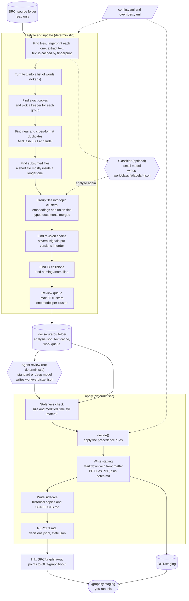

# How docs-curator works

This page explains how the script works. The script is `docs/docs-curator/scripts/curate.py`, one Python file that you run from the command line.

Most of the script is deterministic. That means the same input always gives the same output. Two steps are not deterministic. The agent (Claude) does both of them, not the script:

- Classifying documents whose type is unknown. This step is optional.
- Reviewing the groups of similar documents that the script finds.

The script writes work files for the agent. The agent writes its answers as JSON files, and the script reads them back. The script never calls an AI model itself.

The script also chooses which model should handle each piece of work (sections 2.10 and 2.11). Cheap work goes to a small model. Hard work goes to a stronger model.

## 1. Architecture

The diagram shows the stages. `analyze` and `update` read the source folder and build a plan. The agent reviews the plan in between. `apply` writes the output.



Two folders matter here:

- **SRC** is the source folder, the documents you want to curate. The script never changes it, except for two symlinks (explained in section 6).
- **OUT** is the output folder. You pass it with `--out`. If you leave it out, the default is `~/curated/<name of the source folder>`.

The script refuses to run if OUT is inside SRC, or SRC is inside OUT. That stops the output from being read as input.

The OUT folder holds these files and folders:

- `text/v{EXTRACT_VERSION}/<sha>.md` or `.err`: the text cache. Each name is a file's fingerprint (see section 2.1). A `.err` file marks a file that failed to extract. `EXTRACT_VERSION` is a number in the script. Raising it throws away the whole cache.
- `analysis.json`: the full analysis.
- `work/queue` and `work/verdicts`: the hand-off to the agent. `work/routing.json` groups the queued clusters by model.
- `work/classify/queue` and `work/classify/labels`: the hand-off for the optional classifier.
- `state.json`, `changes.json`, `decisions.jsonl`, `REPORT.md`, and `pdf/<sha>.pdf`.
- `staging/` and `graphify-out/`.

## 2. `analyze`

`analyze` reads every file in SRC and builds the full analysis. It runs the steps in this section in order.

### 2.1 Inventory and text extraction

- The walker (the part that lists files) skips symlinks, which are shortcuts to other files. It also skips anything that is not a file. It skips these folders: `.git`, `node_modules`, `__pycache__`, `graphify-out`, and `.docs-curator`. It visits entries in sorted order, so the same folder gives the same result every time.
- Each file gets a record with these fields:
  - `sha256`: a fingerprint of the file's exact bytes. Two files with the same fingerprint are identical.
  - `size`: the file size in bytes.
  - `mtime_ns`: the last-modified time, in nanoseconds.
  - `format`: the file type, such as `docx` or `pdf`.
- A file with an extension the script does not handle gets the status `not_ingestible`.
- Text extraction is cached by fingerprint, in `text/v{EXTRACT_VERSION}/<sha>.md`. If extraction fails, the failure is cached as `<sha>.err`. A bad file is then not tried again on every run.
- Plain text files (`.md` and `.txt`) are read with three text encodings, tried in this order: utf-8-sig, cp1252, then latin-1. An encoding is a rule for turning bytes into letters. The first one that works is used.
- Structured data files keep their structure. These are `.xml`, `.json`, `.csv`, `.yaml`, and `.yml`.
  - XML must be well-formed, which means every tag is opened and closed correctly.
  - JSON must parse.
  - YAML must load. A file with several YAML documents is fine.
  - A CSV that contains NUL bytes (zero-value bytes that text files should not have) is also invalid.
  - A file that fails these checks gets the status `unreadable`.
  - Each valid file is staged as its raw text inside a fenced code block, labeled `xml`, `json`, `csv`, or `yaml`. `.yml` files use the `yaml` label. The fence gets longer if the content has backticks in it.
  - The description is the filename without its extension.
- PDF, Word, Excel, and PowerPoint files are converted to text by the `heavy-file-ingestion` skill (`ingest.py`). The converted chunks are joined in INDEX order.
  - Before conversion, the script checks that each Office file is a real zip archive. Office files (.docx, .xlsx, .pptx) are zip archives inside. The script checks that each PDF starts with the bytes `%PDF`.
  - The converter does not report an error for a corrupt file. It quietly returns plain text. These checks catch corrupt files first.

### 2.2 Normalization

`normalize` turns each file's text into a token stream. A token is a word made of lowercase letters and digits. Every later comparison uses this stream.

- It removes these parts first:
  - speaker notes in PowerPoint files,
  - HTML comments,
  - lines like "Page 3 of 9" or "Slide 4".
- It lowercases the text and then extracts the tokens.
- A file with zero tokens gets the status `text_free`. It is still staged, with an empty body.
- The script does not run OCR (optical character recognition, which reads text from images). Scanned pages stay empty.

### 2.3 Exact duplicates and keeper selection

Files with the same fingerprint are exact duplicates. In each group, one file is the keeper. The others are excluded.

The keeper is the file with the smallest sort key:

```
(FORMAT_RANK, -token_count, -descriptive_score, filename_marker_count, path)
```

Each part is compared in order. A smaller number wins. A minus sign means that more is better.

- **Format rank** prefers editable formats: `md` first, then `docx`, `pptx`, `xlsx`, `pdf`, `txt`, `xml`, `json`, `csv`, and `yaml` or `yml` last.
- **Token count** prefers the file with more text.
- **Descriptive score** counts the words in the filename that appear in the first 300 tokens of the text. Only words with 4 or more letters count, and common words such as "the" and "and" are skipped. This prefers `vendor-security-policy.docx` over `doc1.docx`. To turn this off, set `keeper_prefers_descriptive_name` to false.
- **Marker count** prefers filenames without words like `final` and `copy`.
- **Path** breaks any remaining tie. It keeps the choice the same on every run.

### 2.4 Near and cross-format duplicates

A near duplicate has almost the same text as another file but different bytes. A cross-format duplicate has the same content in a different format, such as a Word file and its PDF. The script compares only keepers that have at least 5 tokens.

1. **Shingling.** Each document is broken into word pairs, called bigrams. Each pair is hashed to a 64-bit number with blake2b, a hash function. The set of hashes is the document's shingles.
2. **Candidate generation.** The script uses MinHash to estimate how much two sets overlap. It uses 128 hash functions. `seed=1` makes the random choices the same on every run. The MinHash results go into an LSH index (locality-sensitive hashing, which puts likely matches in the same bucket). The threshold is 0.35. This step avoids comparing every pair of documents, which would take too long.
3. **Confirmation.** The script scores each candidate pair with `rapidfuzz.Indel.normalized_similarity`, on the token lists. This score runs from 0 to 1. It counts the longest run of tokens the two documents share, in order. Order matters here. The default cutoff is 0.90.
4. **Large documents.** If either document has more than 50,000 tokens, the script uses the Dice coefficient instead. Dice compares which words appear, and ignores order. It gives lower scores, so it errs toward not matching.
5. **Edge kind.** A pair is `cross` if the two formats differ. Otherwise it is `near`.
6. **Grouping.** The script joins matching pairs into groups. It uses union-find, which joins two items if they are linked directly or through other items. The keeper is again the file with the smallest sort key.

At this stage, only cross-format losers leave the alive set. "Alive" means the file is still in play for later stages. Same-format near duplicates stay alive, so later stages can still see them. This matters because `near_duplicate_action: flag` is the default. The default marks near duplicates. It does not exclude them.

### 2.5 Subsumption

Subsumption finds a short document that is mostly inside a longer one. Examples are an excerpt or a summary.

- An inverted index maps each shingle hash to the documents that contain it. This lets the script look up which documents share a shingle.
- For each document A with at least 20 tokens, the script takes a fixed sample of its 64 smallest hashes. The sample is called a bottom-k sketch. It is small, and it is the same on every run. Each other document B gets one vote for each sampled hash it contains.
- B passes the cheap filter if both of these are true:
  - B contains at least 80% of the sample.
  - A is at most 80% of B's length. The rule in config is `1 - subsumed_min_length_ratio`.
- The exact check measures containment. Containment is the share of A's word pairs that also appear in B. It must be at least 0.95, or 95%.
- The script only flags subsumed documents. It never excludes them automatically.

### 2.6 Topic clustering

A cluster is a group of documents on the same topic.

- Each alive document is represented by its first 400 words, with comments removed.
- Each document is turned into an embedding. An embedding is a list of numbers that stands for the meaning of a text. The script uses one of two methods:
  - fastembed with the model `BAAI/bge-small-en-v1.5`, a small AI model, or
  - TF-IDF, a word-counting method that gives rare words more weight. It uses sublinear term frequency and English stopwords.
- Each embedding is scaled to length 1 (this is called L2 normalization). After that, a dot product between two embeddings equals their cosine similarity. Cosine similarity is a score from 0 to 1 that says how closely two vectors point the same way. A score of 1 means they point the same way.
- The cut-off for "similar" is `max(floor, mean + z·std)`. It is calculated over all pairs of documents.
  - `mean` is the average score across all pairs.
  - `std` is the standard deviation, which measures how spread out the scores are.
  - `z` is 1.0 by default.
  - `floor` is the lowest the cut-off can go. It is 0.78 for fastembed and 0.25 for TF-IDF.
- The cut-off depends on the rest of the corpus. If the documents are alike, the cut-off goes up. This keeps the script from grouping everything together.
- Pairs at or above the cut-off are joined with union-find. This is called single linkage. If A is linked to B, and B to C, then A, B, and C are one cluster, even if A and C are not similar. Clusters can grow in chains. Only clusters of size 2 or more are kept.
- The cluster ID is the first 16 characters of the SHA-256 of the sorted member fingerprints. The ID stays the same when files are renamed or moved. It changes when the members or their content change. That is why a saved verdict stops matching when its cluster changes. The script never reuses an old answer for a group that is no longer the same.
- If fastembed cannot load its model, for example when you are offline, the run stops. The error suggests switching to TF-IDF. The script does not switch on its own.

### 2.6.1 Typing and the classifier (optional)

A document's type says what kind of document it is. It can be `requirement`, `adr` (architecture decision record, a short document that records one decision and why), or something else. The type decides whether the requirement-vs-ADR check runs.

The type comes from three places, checked in this order:

1. The `type` field in the front matter. Front matter is the metadata block at the top of a Markdown file, between two `---` lines.
2. Path patterns in the config. These are glob rules, such as folder-name patterns.
3. Classifier labels, if `classify_untyped: true` is set. This is the optional third source.

With the classifier on:

- A document is queued for classification if all of these are true:
  - it has no type from any source,
  - its front matter has no `type` field of any kind. Even `type: policy` counts, because it means "something else", and
  - it has no label yet.
- The queue file is `work/classify/queue/<batch_id>.json`.
- Each batch holds 25 documents (`classify_batch_size`). Each entry has the title and the first 300 words (`classify_snippet_words`).
- At most 500 documents are queued in one run (`classify_max_docs_per_run`). The rest are listed as deferred, which means they wait for a later run.
- The agent writes `work/classify/labels/<batch_id>.json`. It has one entry per document, with these fields:
  - `sha256`,
  - `type`: `requirement`, `adr`, or `other`,
  - `confidence`: a number from 0 to 1.
- On the next `analyze`, a `requirement` or `adr` label sets the document's type. This happens only if the confidence is at least `classify_min_confidence` (0.8). The type source is recorded as `classifier`. From then on, the document counts as typed, the same as a type from front matter.
- Any other label, or a label with lower confidence, leaves the document untyped. The script does not queue it again.
- Labels are keyed by the file's fingerprint, like the text cache. Renaming a file keeps its label. Editing a file drops it.
- Classification must happen before review. A new type can change which clusters exist, so the review must see the final clusters.

### 2.7 Revision chains

A revision chain is a set of versions of one document, ordered from oldest to newest. For example, `plan.docx`, `plan v2.docx`, and `plan final.docx` could form a chain.

**Which files are candidates.** A candidate is an alive document that is in the same cluster as others and has the same normalized filename stem. The stem is the name with the version words and markers removed. The script groups candidates by `(directory, stem, cluster_id)`. If `revision_chain_scope` is set to `corpus`, the directory is left out of the key. Then files in different folders can form one chain.

**How names are read.** `parse_name` splits the filename into words and finds markers anywhere in the name:

- Version words: `v2`, `ver1.3`, `rev4`, and `version 2`.
- Strict markers: `copy of`, a trailing `copy`, `updated`, and `revised`. The script trusts these.
- Ambiguous markers: `final`, `latest`, and `current` add 1 to a file's newness score. `draft` subtracts 1. These words are often right, but not always, so the script uses them only in limited ways (see the voting rules below).

The words that remain form the stem.

**Signals.** `analyze_chain` builds one ordering for each signal. Each ordering goes from oldest to newest.

- The filename: the version number first, then the count of strict markers.
- The ambiguous markers.
- The version line inside the text, such as `Version 2.1`. The script looks in the first 60 lines.
- The date line inside the text, such as `Last updated: 2024-03-01`.
- The `dcterms:modified` metadata in docx, pptx, and xlsx files. This is the "last modified" time saved inside the file.
- The file's modified time on disk (mtime).

If a signal cannot order every file, it abstains, which means it does not vote. A signal cannot order the chain when a file lacks the information, or when two files tie.

**Voting rules.**

- Ambiguous markers vote only when they agree with an ordering from the text. If they do not agree, the script records the marker as `ambiguous_ignored`.
- mtime never votes when another signal exists. Copying and syncing files change mtime, so it is not reliable. When no other signal exists, mtime is the fallback. If it agrees with the chosen order, the script records `mtime_agrees`.
- The chosen order comes from the highest-priority signal that votes. The other signals are counted as `agreeing` or `contradicting`.
- A chain is `deterministic` if at least two signals agree and none contradict.

### 2.8 Identifier collisions

An identifier is a code that points to a record, such as the ticket `PROJ-123`. A collision happens when the same identifier means different things in different files.

The default pattern is `\b[A-Z][A-Z0-9]{1,9}-\d{1,6}\b`. It matches an uppercase code of 2 to 10 letters or digits, then a dash, then 1 to 6 digits. The pattern is configurable.

The script finds identifiers in three places, called sites:

- **The filename.** Underscores become spaces first. The pattern's word boundary does not match next to an underscore, so the spaces are needed.
- **Markdown headings** that start with an identifier.
- **Table rows** where the key column's header is one of these: `id`, `ticket`, `key`, `ref`, or `number`. The list is set by `identifier_title_headers`.

Each site gives an identifier and the title text next to it. The script reports an identifier that appears in at least two files, when some pair of their titles has a word-set Jaccard score below 0.2. Jaccard is the share of distinct words that two titles have in common. A score of 0 means no words in common. The script checks keepers only.

### 2.9 Naming anomalies

The script flags two cases:

- An exact-copy group where the files have different normalized names.
- A near-duplicate pair with a similarity of 0.999 or more, and different names. These are the same content filed under conflicting names.

### 2.10 Review queue

The review queue lists the clusters that the agent must review.

- The clusters are sorted by size, largest first. Ties are broken by cluster ID.
- A cluster that already has a verdict file is skipped. A verdict is the agent's written answer for one cluster, saved as a JSON file.
- At most 25 clusters are queued in one run (`max_llm_clusters_per_run`).

Each queue item contains:

- the member files, with the path to each text-cache file, the list of other places each exact copy appears (`also_at`), and the token count of each member,
- the revision signals for each member,
- the revision chains and near-duplicate pairs that involve these members,
- `read_words` (6000), the number of words the reviewing agent should read.

Clusters that do not fit in this run appear in the report as pending.

### 2.11 Review routing

Routing chooses how strong a model reviews each cluster. Each queue item gets a `review` field with three parts: `tier`, `model`, and `reasons`. The tier is `standard` or `deep`. The choice uses only deterministic signals, which means the same input always gives the same choice.

| Signal | Reason | Why it needs the stronger model |
|---|---|---|
| The cluster has requirements and ADRs (`decision_check`) | `requirement_vs_adr` | The model must decide whether a requirement and a decision can both hold, and whether the ADR still applies. |
| A revision chain that is not `deterministic` | `ambiguous_revision_chain` | The signals could not put the chain in order, so the verdict decides which file is kept. A wrong verdict drops a file. |
| At least `deep_review_min_members` (6) members | `large_cluster` | There are more pairs to compare for contradictions. |
| A standard review found a problem | `escalated_*` | See Escalation below. |

- If any reason applies, the tier is `deep`, and the model is `review_model_deep`. The default is `opus`.
- If no reason applies, the tier is `standard`, and the model is `review_model_standard`. The default is `sonnet`.
- The model names are aliases. The agent passes each alias to a subagent, which is a separate AI session that the agent starts for one task. The script only records the names. It does not choose the model itself.
- `work/routing.json` lists the queued IDs for each model, plus the escalations.

**Escalation.** A verdict can include `review_tier: standard`. On the next `analyze`, the script queues a standard verdict again at the deep tier. This happens in two cases:

- the verdict found a conflict (`escalated_conflict_found`), or
- the verdict has a revision with confidence below `low_confidence_threshold` (`escalated_low_confidence_revision`).

An escalation uses one slot of `max_llm_clusters_per_run`. The deep review overwrites the verdict with `review_tier: deep`. That ends the loop. Verdicts without a `review_tier` are never queued again. So older verdicts, and the verdicts that the knowledge-graph pipeline (`kg`) copies forward between runs, are not affected.

## 3. `update`

`update` is `analyze` plus a comparison. It works like this:

1. It saves the old list of file paths and their fingerprints.
2. It runs `analyze` again. Cached text makes this quick.
3. It compares the old and new lists. This gives the added, modified, and removed files.
4. It lists three things in `changes.json`:
   - the clusters that contain a new or changed file,
   - the clusters that are queued right now,
   - the stale verdicts, which are verdicts that match no current cluster.

## 4. `decide`

`decide` is a pure function. That means it reads its inputs and returns a result. It changes nothing. Its inputs are the analysis, the config, the overrides, and the verdicts. Its output is one decision for each file.

The rules run in this order. Each file gets the first decision that applies to it.

1. **Terminal states.** Files with the status `not_ingestible` or `unreadable` are final. Nothing else applies to them.
2. **Exact duplicates.** Copies that are not the keeper are excluded with the reason `exact_duplicate`.
3. **Cross-format duplicates.** The loser is excluded with the reason `format_duplicate`.
4. **Near duplicates.** The loser is excluded with the reason `near_duplicate` if the action is `exclude`. Otherwise it is marked to be flagged.
5. **Back-pointing.** An exact copy whose keeper was excluded is pointed at the final keeper.
6. **Revisions.**
   - In a `deterministic` chain, the script excludes every file except the newest. Those files get the reason `superseded`. This happens even if the agent disagrees. A disagreement produces a warning.
   - In a chain that is not `deterministic`, the agent's verdict must have a confidence of at least 0.75. If it does not, the file is kept with the reason `low_confidence_keep`.
   - A verdict that names a revision outside every computed chain follows the same confidence rule.
7. **Near-duplicate flag.** This is applied only when the keeper is not excluded. A flag must never point at a file that is missing.
8. **Subsumed flag.** The same rule applies. It is set only when the container file, the longer file, is kept.
9. **Default.** Everything else is `include`, with the reason `unique`.
10. **Overrides.** An entry in `overrides.yaml` wins over all the rules above. The exception is `unreadable` and `not_ingestible`, which overrides cannot change.
11. **Decks.** Kept `.pptx` files change from `include` to `convert`.

The pattern is cautious. Removing a file needs strong evidence. Any file where the evidence is unclear is kept and flagged.

## 5. `apply`

`apply` writes the output. It runs these steps:

- **Staleness check.** `apply` compares each source file's size and `mtime_ns` with the values recorded in step 2.1. If any file changed, `apply` stops and tells you to run `analyze` again.
- **Rebuild.** The `staging/` folder is deleted and rebuilt on every run. So running `apply` twice gives the same result.
- **Markdown output.** Each kept file is written as `<path>.md`. A file that is already `.md` keeps its own path. The front matter has these fields, in this order:
  - `source_path`
  - `source_format`
  - `sha256`
  - `status`
  - `description`

  The description is the first H1 or H2 heading in the file. If there is none, it is the first non-empty line. If there is none, it is the filename without its extension. It is cut to 160 characters.

  For `.md` sources, the existing front matter is read and moved under `source_front_matter`. If it cannot be read, the script adds a warning and leaves the front matter in the body.
- **Decks.** PowerPoint files are converted to PDF with LibreOffice, using the command `soffice --headless --convert-to pdf`. Here is how the conversion is kept safe:
  - Conversions run one at a time.
  - Each one works on a temporary copy of the file, so the source is never touched.
  - Each one uses its own LibreOffice profile folder (`-UserInstallation`). This stops it from clashing with a LibreOffice window that you have open.
  - A conversion that runs longer than 300 seconds is stopped.
  - The PDF is cached by fingerprint.

  Speaker notes come from python-pptx. They go into a file named `<deck>.notes.md`. If a conversion fails, the file is marked `unreadable` with the reason `conversion_failed`.
- **Name collisions.** When two files would get the same output name, the file that loses gets a suffix: `.dup-<sha8>`. The `sha8` is the first 8 characters of its fingerprint. The script also adds a warning.
- **Historical sidecars.** A sidecar is an extra file written next to the main output. When a superseded file's verdict lists `unique_content`, the file is written to `_curated/historical/`. This way, nothing unique is lost.
- **Conflict check.** Each conflict in a verdict lists statements, and each statement has a file path and a quote. The script checks that the quote appears in the cached text. Before comparing, it ignores differences in spacing and capital letters. A quote that does not appear is marked `[quote not verified]` in `_curated/CONFLICTS.md`. This catches quotes the agent made up.
- **Audit outputs.**
  - `decisions.jsonl` is a JSON Lines file. JSON Lines means one JSON record per line. It has one line per file. Each line holds `run_id`, the action, the reason, `kept_instead`, the evidence, and the confidence.
  - `REPORT.md` is written by `build_report`.
  - `state.json` holds the counts.

  At the end, `apply` prints the `link` and `/graphify` commands for you to run next.

## 6. `link`

`link` creates two symlinks. A symlink is a shortcut that points to another folder. The two symlinks are:

- `SRC/graphify-out` points to `OUT/graphify-out/`.
- `SRC/.docs-curator` points to `OUT/.docs-curator/`.

`link` creates `OUT/graphify-out/` if it does not exist yet. It can also add `.docs-curator` to a `.gitignore` file, if you ask for that.

These two symlinks are the only changes the tool makes inside the source folder. The rest of the source stays unchanged.

`link` is safe to run again. If a symlink already points to the right place, nothing happens. `link` refuses to do two things:

- replace a real folder or file that is already there, or
- replace a symlink that points somewhere else.

In both cases, it stops and tells you what to move or remove.

The walker skips both `graphify-out` and `.docs-curator`. So the symlinks are never read back in as input.

## 7. Design properties and limits

**Properties**

- Caches keyed by fingerprint make reruns quick. A run that stopped can pick up where it left off.
- Stable cluster IDs let verdicts be reused. A verdict stops matching when its cluster changes.
- Several separate signals must agree before any file is excluded.
- The source folder is never deleted or changed. The only changes are the two symlinks from section 6.

**Limits**

- Clustering builds a table that compares every document with every other document. This is an n×n similarity matrix, where n is the number of alive documents. Memory and time grow with the square of n. Single linkage can also join loosely related documents into one large cluster.
- Chains only form inside one cluster, one folder, and one filename stem. A revision with a different stem is not linked, unless the agent's verdict catches it.
- Indel scoring takes time that grows with the square of the document length, for each pair. Very long documents use the weaker Dice fallback.
- Scanned PDFs and images have no text. They are staged empty, so they cannot be matched by content.
- Routing is advice. The script cannot make the agent use the model it names. The script can only tell which model wrote a verdict by reading the `model` field that the agent fills in.
