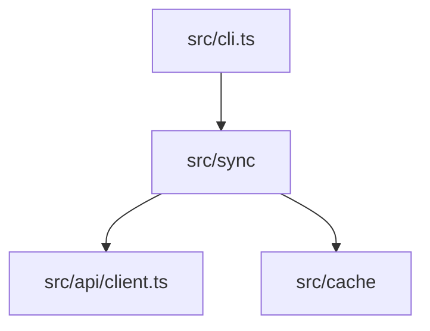

# ADVANCE Level Template

Everything in [STANDARD](standard-level-template.md), plus the sections below. Include a section only if the project has real content for it. Diagram rules are in SKILL.md: draw only what the code supports, at most 15 nodes, every node a real file, module or service.

## Added sections

1. **Architecture**
   - *System overview*: `graph TD` of the real components and how they connect.
   - *Data flow*: `sequenceDiagram` only for a real multi-step or multi-service flow.
   - *Data model*: `erDiagram` only if the repo defines a schema or models.
   - *Decision or pipeline flows*: `flowchart` only for a real decision, error path or deploy pipeline.
   - If none of these apply, write a short prose description and no diagram.
2. **Configuration**: environment variables (name, purpose, required or default) read from `.env.example`, config files, or the code that reads them. Name the config files. Never include real secret values.
3. **API Reference**: endpoints, CLI commands or exported functions, taken from routes, handlers, or the public API. For each: method and path (or signature), parameters, response, and an error table if the code defines errors. Skip if the project exposes no API.
4. **Testing**: where tests live, the real commands (all, unit, coverage, single file), and the framework. Add coverage numbers only if a report exists.
5. **Deployment**: only what the repo supports (Dockerfile, CI workflows, deploy scripts, platform config). Give the real build and run commands and environment-specific settings.
6. **Troubleshooting** (optional): only issues evidenced in the repo, such as documented known issues, debug flags, or log locations.

## Example

````markdown
## Architecture



## Configuration

| Variable | Purpose | Default |
|----------|---------|---------|
| `ACME_TOKEN` | API token | required |
````

## Rules

- Before writing, validate every Mermaid block (see SKILL.md step 7).
- No footer or generator note.
