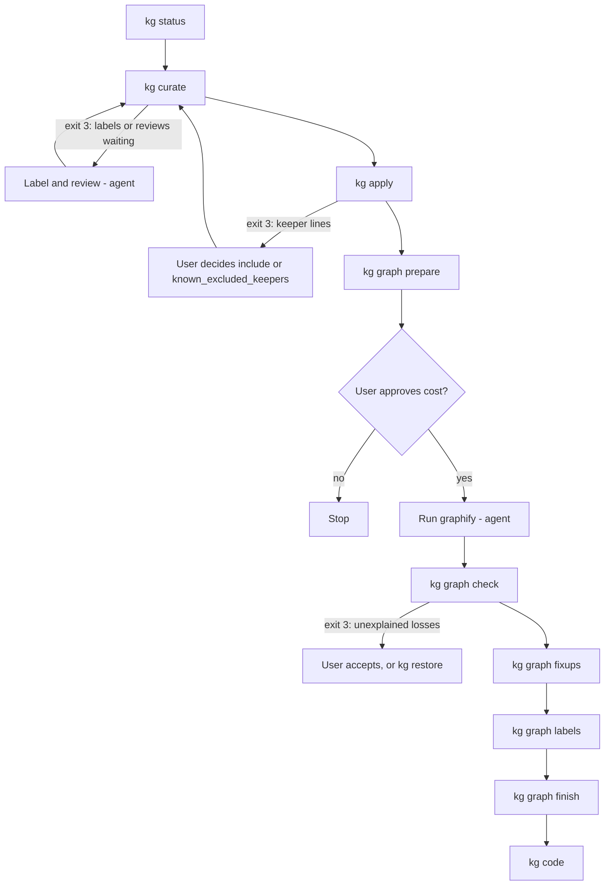

# Knowledge-graph workflows

This document explains the workflows in the `knowledge-graph` skill. It covers what each one does, who does each step, and when the pipeline stops and waits for a person.

The skill builds two graphs for a repository:

- **Docs graph.** `docs-curator` cleans up the repo's documents. `graphify` then builds `graph.json` from them. Output lives in `~/curated/<repo>/`.
- **Code graph.** `codegraph` indexes the code into `<repo>/.codegraph/`.

A single script, `kg`, does every step that can be done by rule. The agent does the steps that need judgment: writing cluster verdicts, running graphify's extraction, and naming new communities. It also asks the user before anything costs tokens.

## Workflows at a glance

| Workflow | When to use it | Main commands |
|----------|----------------|---------------|
| [Setup](#1-setup-once-per-repo) | First time on a repo | `kg init`, `kg preflight --fix` |
| [Refresh run](#2-refresh-run) | Rebuild or update the graphs | `kg status`, `kg all`, `kg graph ...`, `kg code` |
| [Restore](#3-restore) | A run failed or lost data | `kg restore` |
| [External repo curation](#4-goal-scoped-curation-of-an-external-repo) | A goal needs facts that only another repo holds | `kg needs ...`, `kg external ...` |
| [Related repos](#5-related-repos) | Read another repo's existing graph | `graphify query --graph` |

## Who does what

| Step type | Done by |
|-----------|---------|
| Snapshots, overrides, PHI checks, gating, cost estimate, symlinks | the `kg` script |
| Cluster verdicts, classifier labels, graphify extraction, community names | the agent |
| Approving PHI folders, cost, scope, restores, force overrides | the user |

The script stops and says so whenever a person is needed. The agent never works around a stop.

## 1. Setup (once per repo)

1. `kg init <repo>` creates `~/curated/<repo>/` with `kg.yaml`, `config.yaml`, `overrides.manual.yaml` and a `.gitignore`, then runs `git init` there. It never overwrites existing files.
2. Ask the user for the repo's PHI folders and write them to `phi_globs` in `kg.yaml`. If there are none, record `phi_globs: []` once the user confirms. Review `exclude_groups` with them too.
3. Ask: "Index this repo with `codegraph init`? It writes `.codegraph/` at the repo root." Only after a yes, run `kg init <repo> --codegraph`.
4. Run `kg preflight --fix`. The only thing `--fix` changes is turning codegraph telemetry off. Fix every `FAIL` before going on.

Commits to the curated folder's own git repo belong to the user. Mention uncommitted changes there, but do not commit them.

## 2. Refresh run

Start with `kg status`. It shows the branch gate, drift since the last curate and graph, pending reviews, PHI findings, backups, and the next step.

`kg all` runs the scripted steps in order and stops before the first one that needs a person.

### Step 1. `kg curate`

- Takes a snapshot first.
- Regenerates the overrides.
- Runs docs-curator `update` (or `analyze` the first time). Each PHI glob is passed as `--no-extract`, so PHI text is never extracted. Any PHI text left in the cache is purged.
- Carries old verdicts forward and archives stale ones.

Carry-forward rules:

- A cluster that only lost members keeps its old verdict, marked done. This holds when the old cluster had at most `carry_forward.subset_max_members` members (default 25) and the verdict was not a partial read. Larger or partly read clusters come back for a full review.
- A pending cluster is auto-closed when fewer than two of its members can reach staging, because no verdict could change staging. The verdict carries a `kg_auto` field with the reason. Each `curate` and `apply` re-checks this and reopens a cluster that now has two or more eligible members. Never add `kg_auto` to a verdict you wrote yourself.

If `config.yaml` has `classify_untyped: true`, documents with no `type` front matter and no glob match are queued for classifier labels. Override-excluded and PHI files are never queued. When any batch has no labels, `kg curate` stops right after the PHI purge and exits 3. Label the batches (step 2), then run `kg curate` again.

### Step 2. Label and review (agent)

Run `kg review`. It lists what is waiting:

- **`label:`**: classifier batches. Label each one with a subagent on the model named in the batch (Haiku by default). Write `.docs-curator/work/classify/labels/<batch_id>.json`. Run `kg curate` again. Repeat while batches remain, because large corpora are queued in parts.
- **`verdict:`**: clusters needing a verdict. Follow the docs-curator skill's step 2 and write `.docs-curator/work/verdicts/<id>.json`. Route by the queue item's `review` field: Sonnet for `standard`, Opus for `deep`. Write `review_tier` and `model` in the verdict.
- **`recheck:`**: a verdict copied from a re-numbered cluster that overlaps it by at least `carry_forward.verdict_overlap`. Read only the `new_members` in its `carried_forward` block. Check them against the carried revisions and conflicts, and against older documents on the same topic for status claims they contradict. Then set `carried_forward.review_done: true`.
- **`escalate:`**: a standard verdict that found a conflict or a low-confidence revision. Redo it with the deep model, and set `review_tier: deep`.
- **`deferred`**: clusters past docs-curator's `max_llm_clusters_per_run`. After this round, `kg curate` queues them. `kg apply` refuses until none are left, or until the cap in `config.yaml` is raised.

After the verdicts are in, run `kg curate` once more. Escalations appear only after that run.

When a changed document reverses a rule, grep the tracked docs for the old wording. `git diff` of the changed files is the quickest way to find what to look for.

### Step 3. `kg apply`

Runs docs-curator `apply`. It:

- writes the `graphify-out` and `.docs-curator` symlinks in `$HOME` form,
- stops on PHI in the cache or staging,
- checks keeper chains,
- runs the mappers for `related_repos`.

Exit 3 with `keeper:` lines means content left staging because its keeper is excluded too. Show the user each line. Offer either an include in `overrides.manual.yaml` or adding the path to `known_excluded_keepers`. Then run `kg curate` and `kg apply` again.

### Step 4. `kg graph prepare`

- Takes a snapshot.
- Re-keys graphify's manifest if needed. Without this, every update would re-extract the whole corpus.
- Writes `graph.excludes` from `kg.yaml` into graphify's exclude file (`.graphify_build.json`).
- Lists changed and deleted files, plus graph sources that the exclude rules now leave out.
- Estimates the token cost. It prices the changed files (bytes / 4, times a content multiplier) plus a fixed overhead per extraction agent. A prune-only run is estimated at 0. `kg graph finish` measures the real multiplier, and the next prepare uses it.
- Lists oversized files.

### Step 5. Ask the user

Ask one yes/no question: "Update the docs graph? N changed files, about T input tokens."

If `over_cap` is true, say it exceeds the cap and get a separate, explicit yes for the cost. Approval for an earlier run does not carry over.

### Step 6. Run graphify (agent)

Run the `graphify_command` printed in `.kg/graph-plan.json`, from the repo root. Follow the graphify skill and its `references/update.md`. Also:

- Give each `big_files` and `long_files` entry its own extraction chunk (`long_files` are over 2,000 lines). Tell that agent to parse the file with `python3 -I` rather than Read.
- Tell every extraction agent to read `graphify-out/graph.json` read-only and reuse existing node IDs for its files, so cross-file edges survive.
- Tell every extraction agent: when a file cites a document by an identifier in `graph.citation_ids` (default `ADR`), add a node whose label starts with that identifier (for example `ADR-005 PDF overlay`), even if the cited document is in another chunk. `kg graph fixups` links each one to the cited file's node.
- **Prune with the plan's list.** In the merge step, pass `prune_sources` from `.kg/graph-plan.json` to `build_merge`. That list is the deleted files plus the excluded files. graphify's own procedure prunes deleted files only, so without this the nodes of a newly excluded file stay in the graph.
- If the plan has `excluded` files but nothing changed or was deleted, graphify reports "No files changed" and stops. Continue anyway: write the empty extraction from `references/update.md` and run the merge with the plan's `prune_sources`.

Then, in this order:

1. **After the merge and before Step 4 of graphify: `kg graph check`.**
   - Exit 0: every lost node comes from a changed, deleted or newly excluded file. If `to_json`'s shrink guard refuses, pass `force=True`.
   - Exit 3: show the user the unexplained losses. Use `force=True` only after they accept them. Otherwise stop and offer `kg restore`.
2. **`kg graph fixups`**, right after the check. It applies `~/curated/<repo>/graph-fixups.yaml` to the merged extraction before graphify builds and clusters: `links` to add, `merge` entries that fold a duplicate node into the one to keep, and self-loops always dropped. It also links cross-chunk citations. Nodes removed by a listed merge count as explained in `kg graph check`. Add a fixup only after checking the two nodes are the same thing, not two instances (for example the same clause on two forms).
3. **`kg graph labels`** at graphify's Step 5. Start `LABELS_DICT` from `carried` in `.kg/labels-proposed.json`. Name only the communities under `needs_name`, keeping labels unique. A community is carried only if at least `label_min_known` of its members had a label before, so a community made mostly of new material gets a fresh name.

### Step 7. `kg graph finish`

Checks the new graph for PHI, records the run, and prunes old snapshots. Report the node, edge and community counts and the query line.

### Step 8. `kg code`

Runs `codegraph sync`. It works on any branch, because the code index follows the current checkout.

### Gating

`curate`, `apply`, `graph prepare` and `all` run only on the branches listed in `kg.yaml` (default `main`, `develop`, `develop-*`) with a clean working tree. When one refuses (exit 2), tell the user why and stop. Pass `--allow-any-branch` only when the user explicitly asks for it in that turn. The override is logged in `.kg/runs.jsonl`.

`kg code`, `status`, `review`, `preflight` and `restore` are not gated.

### PHI added to an existing repo

When a folder is newly added to `phi_globs`, the existing graph may still hold its nodes. `kg curate` and `kg apply` remove the folder from the cache and staging. `kg graph prepare` then lists those graph sources under `phi_pruned` and adds them to `prune_sources`. Run that graph update promptly, because `kg graph finish` exits 4 if any PHI node remains.

## 3. Restore

- `kg restore` shows what the latest snapshot would put back.
- `kg restore <timestamp> [--only graph|curator]` picks a specific snapshot or part.
- Nothing is restored without `--yes`, so get the user's yes first.

Snapshots live in `~/curated/<repo>/backups/`. The newest `backups.keep` (default 3) are kept. Two guards protect them: an unchanged state reuses the latest snapshot instead of adding one, and the snapshot an unfinished graph run started from (named in `.kg/graph-plan.json`) is never pruned.

**If a graphify run fails partway, restore first, then retry.** `kg graph prepare` warns when the previous run never reached `kg graph finish`, and keeps that run's pre-run snapshot as the restore point. Offer `kg restore <that snapshot> --only graph`, and run it with `--yes` once the user agrees, before preparing again.

## 4. Goal-scoped curation of an external repo

Use this when the primary repo's goals need facts that only another repo holds. Curating the whole external repo is the cost to avoid, so curate the primary first and the external repo only as far as its open questions require. Steps go in order, and each waits for the user where noted.

1. **Know the goals.** With the primary curated and graphed, run `kg needs init`. Propose goals from the curated docs and the graph with `kg needs add-goal "<text>"`. Show them to the user, and run `kg needs approve-goals` only after their yes. Changing a goal clears the approval.
2. **Write questions.** `kg needs add-question "<text>" --goal gN --expects <kind of fact>`. Each question must serve a goal and ask for something that would live in another repo.
3. **Gate each question against the primary graphs.** Query the docs graph (`graphify query`) and the code graph (`codegraph explore`).
   - Answered: `kg needs set qN --status answered-internally --answer ... --source ...`.
   - Not answered: `kg needs set qN --status external-only --evidence "<the queries that came back empty>"`. `kg` refuses `external-only` without evidence.
   - No `external-only` questions means no external curation.
4. **Register the clone.** `kg external add <name> --path <local clone> --phi-glob <glob>...`, or `--no-phi` after the user confirms the external repo has no PHI paths. Ask them; do not reuse the primary's globs. The clone must already exist. `kg` never clones, fetches or writes into it, and warns if its tree is dirty.
5. **Inventory, then pick.** `kg external inventory <name>` lists candidate files with sizes and first headings only, never PHI paths. Choose the files each `external-only` question needs and write `~/curated/<repo>/external/<name>/scope.yaml` (`repo_sha`, `files: [{path|glob, questions: [qN]}]`). Every file must serve a question.
6. **Approve the scope.** `kg external scope <name>` validates it and prints the file count and token estimate. Ask the user one yes/no with those numbers. Over `external.max_files` (default 50) or `external.cost_cap_tokens`, say so and get a separate yes. Then run `kg external scope <name> --approve`, adding `--accept-over-cap` for an overage. Approval for an earlier scope does not carry over.
7. **Build and review.** `kg external build <name>` runs docs-curator with `--scope` and the external PHI globs as `--no-extract`, and pins the clone's commit. Review queued clusters as in the main run (the work dir is `external/<name>/.docs-curator/`), then run `kg external apply <name>`. There is no `link` step, because the clone is never touched.
8. **Graph it.** Ask the user to approve the graphify run with its cost, as in the main run. Run graphify from `external/<name>/` on its `staging/`, then `kg external finish <name>`. That checks for PHI and records the graph as **partial coverage**.
9. **Answer.** Query the scoped graph and cite it as "scoped graph, partial coverage". A missing fact is not proof it is absent from the repo. Record each answer with `kg needs set qN --status answered-externally --answer ... --source <path>`.
10. **Still unanswered?** Propose added files for that question only, then repeat steps 6 to 8. Each question gets at most two widening rounds, and `kg external scope --approve` refuses a third. After that, run `kg needs set qN --status unanswered` and report it.

Later maintenance:

- `kg external status <name>` reports drift only in scoped files.
- A refresh is `kg external build <name>`, which re-curates only the changed files.
- After retiring a question, `kg external prune <name>` lists files that served only retired questions. Rewrite the scope with `--yes` only after the user agrees.

The primary's gates, snapshots and PHI hard stop still apply. External builds take their own snapshot in `external/<name>/backups/`.

## 5. Related repos

A `related_repos` entry names another repo whose graph is read-only from here.

- Query it with `graphify query "<q>" --graph <graph>` and cite which graph each fact came from.
- Never rebuild it, run `--update` on it, or write to it from this repo.
- Its optional `mapper` script lives in the curated folder. It gets `KG_SOURCE`, `KG_RELATED_PATH`, `KG_RELATED_NAME` and `KG_OUT` in its environment.

## Exit codes

| Code | Meaning | What to do |
|------|---------|------------|
| 0 | Done | Go on |
| 1 | Failure or preflight blocked | Read the message and fix it |
| 2 | Gate refused | Tell the user. Do not override on your own |
| 3 | Needs a person | Reviews, unexplained node loss, or keeper problems |
| 4 | PHI found | Stop everything and show the user the findings |

## Hard rules

- Never run graphify without the user's yes for this run, with the cost estimate in the question.
- Never pass `force=True` while `kg graph check` reports unexplained losses the user has not accepted.
- Exit 4 (PHI) stops the run. Never stage, extract or graph a path that matches `phi_globs`, and never add an include override for one.
- Never commit to the user's repos, including the curated folder's git repo.
- Never edit `overrides.yaml` by hand. It is regenerated. Hand decisions go in `overrides.manual.yaml`.
- Never write to, fetch into, clone, link into or run `codegraph init` on an external repo. Never curate an external file that no `external-only` question asked for.
- Never install tools or skills. `kg preflight` names what is missing.
