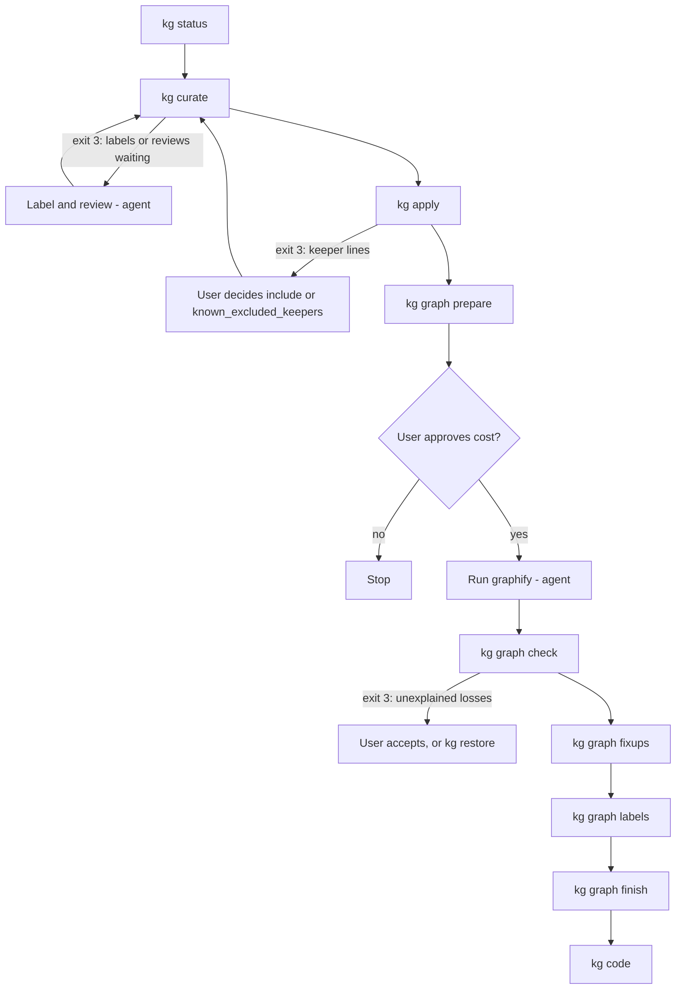

# Knowledge-graph workflows

This page explains the workflows in the `knowledge-graph` skill. It says what each workflow does, who does each step, and when the pipeline stops and waits for a person.

## Background: what the skill builds

The skill builds two graphs for a repository. A graph is a map of facts. Each fact is a node, and each link between two facts is an edge.

- **The docs graph** comes from the repo's documents. The `docs-curator` skill removes duplicates and old revisions, and writes clean copies into a staging folder, `~/curated/<repo>/staging/`. The `graphify` tool reads that folder and writes `graph.json`.
- **The code graph** comes from `codegraph`, a tool that indexes source code into `<repo>/.codegraph/`.

One script, `kg`, does every step that follows fixed rules. The agent (the Claude session that runs the skill) does the steps that need judgment. The user approves anything that costs tokens (the units a model bills by) or changes their data.

The script also keeps PHI (protected health information, which must never enter the graphs) out of both graphs.

### Who does what

| Step type | Done by |
|-----------|---------|
| Snapshots, overrides, PHI checks, branch checks, cost estimate, symlinks | the `kg` script |
| Cluster verdicts, classifier labels, graphify extraction, community names | the agent |
| PHI folders, cost, scope, restores, force overrides | the user |

A snapshot is a saved copy of the graph state that you can restore later. A cluster is a group of related documents that are reviewed together. A verdict is the written decision for one cluster. A community is a group of closely linked nodes in the docs graph.

The script stops and says so whenever a person is needed. The agent never works around a stop.

## Workflows at a glance

| Workflow | Use it when | Main commands |
|----------|-------------|---------------|
| [Setup](#1-set-up-a-repo-once) | You start on a new repo | `kg init`, `kg preflight --fix` |
| [Refresh run](#2-refresh-the-graphs) | You want to rebuild or update the graphs | `kg status`, `kg all`, `kg graph ...`, `kg code` |
| [Restore](#3-restore-a-snapshot) | A run failed or lost data | `kg restore` |
| [External repo curation](#4-curate-an-external-repo-for-your-goals) | A goal needs facts that only another repo holds | `kg needs ...`, `kg external ...` |
| [Related repos](#5-read-a-related-repos-graph) | You want to read another repo's finished graph | `graphify query --graph` |

## 1. Set up a repo (once)

**Mode: how-to.** Commits to the curated folder's own git repository belong to the user. If that folder has uncommitted changes, tell the user. Do not commit them.

1. Run `kg init <repo>`. It creates `~/curated/<repo>/` with `kg.yaml`, `config.yaml`, `overrides.manual.yaml` and a `.gitignore`, then starts a git repository there. It never overwrites existing files.
2. Ask the user which folders hold PHI. Write them to `phi_globs` in `kg.yaml`. A glob is a path pattern, such as `records/**`.
3. If the user says there are no PHI folders, write `phi_globs: []`.
4. Review `exclude_groups` with the user. These are named groups of rules that leave files out of curation.
5. Ask the user: "Index this repo with `codegraph init`? It writes `.codegraph/` at the repo root." After a yes, run `kg init <repo> --codegraph`.
6. Run `kg preflight --fix`. Fix every line that starts with `FAIL`.

If `kg init` stops, read its message. It names what is wrong.

If `kg preflight` prints `FAIL` for a missing tool or skill, the cause is that the tool is not installed. Tell the user which one. Do not install it yourself.

**Background (skip if you only need the steps).** The flag `--fix` changes one thing. It turns codegraph telemetry off, which was agreed for this pipeline.

## 2. Refresh the graphs

**Mode: how-to, with background blocks.** Start with `kg status`. It shows the branch check, changes since the last curate and graph, pending reviews, PHI findings, backups, and the next step.

`kg all` runs the scripted steps in order. It stops before the first step that needs a person.

### Step 1. Curate the documents

Run `kg curate`. It does these things:

- Takes a snapshot.
- Regenerates the overrides, which are the include and exclude rules for each file.
- Runs docs-curator `update`. On the first run it runs `analyze`.
- Passes each PHI glob as `--no-extract`, and purges any PHI text left in the cache.
- Carries old verdicts forward and archives stale ones.

If it exits with code 3, a person is needed. Either classifier labels or cluster reviews are waiting. Go to step 2.

**Background (skip if you only need the steps).** Three rules decide what comes back for review.

- A cluster that only lost members keeps its old verdict, marked done. This holds when the old cluster had at most `carry_forward.subset_max_members` members (default 25) and the verdict was not a partial read. Larger or partly read clusters come back for a full review. A shallow review of a large cluster must not pass to every piece it splits into.
- A pending cluster is closed automatically when fewer than two of its members can reach staging, because no verdict could change staging. The verdict carries a `kg_auto` field that gives the reason. Each `curate` and `apply` checks this again and reopens a cluster that now has two or more eligible members. Never add `kg_auto` to a verdict you wrote yourself.
- If `config.yaml` has `classify_untyped: true`, documents with no `type` in their front matter and no glob match are queued for classifier labels. A label is the document type that a model assigns. Override-excluded files and PHI files are never queued. When any batch has no labels, `kg curate` stops right after the PHI purge and exits 3. Typing merges requirements and ADRs (architecture decision records) into clusters, so the clusters are about to be renumbered.

### Step 2. Label and review (agent)

Run `kg review`. It lists what is waiting. Handle each group in this order.

1. **`label:`** Label each batch with a subagent on the model named in the batch (Haiku by default). Write `.docs-curator/work/classify/labels/<batch_id>.json`. Run `kg curate` again. Repeat until no batches remain.
2. **`verdict:`** For each cluster, follow the docs-curator skill's step 2. Write `.docs-curator/work/verdicts/<id>.json`. Read the `review` field of the queue item. Use Sonnet for `standard` and Opus for `deep`. Write `review_tier` and `model` in the verdict.
3. **`recheck:`** Read only the `new_members` listed in the verdict's `carried_forward` block. Check them against the carried revisions and conflicts. Check them against older documents on the same topic for status claims they contradict. Then set `carried_forward.review_done: true`.
4. **`escalate:`** Redo the verdict with the deep model. Set `review_tier: deep`.
5. **`deferred`** Do nothing yet. After this round, `kg curate` queues these clusters.

After the verdicts are in, run `kg curate` once more. Escalations appear only after that run.

When a changed document reverses a rule, grep the tracked docs for the old wording. `git diff` of the changed files shows what to search for.

If `kg review` lists no cluster verdicts, labelling is not finished. Run `kg status`. It shows the next step as labelling.

If `kg apply` refuses, a review is still open. That includes deferred clusters and escalations. Finish them, or raise the cap in `config.yaml`.

**Background (skip if you only need the steps).** The `recheck:` verdict was copied from a renumbered cluster that overlaps it by at least `carry_forward.verdict_overlap`. A cluster is `deferred` when it falls past docs-curator's `max_llm_clusters_per_run`. Classifier labels are saved with the verdicts in snapshots. A `standard` verdict that finds a conflict or a low-confidence revision is queued again for the deep model.

### Step 3. Apply the verdicts

Run `kg apply`. It does these things:

- Runs docs-curator `apply`.
- Writes the `graphify-out` and `.docs-curator` symlinks in `$HOME` form.
- Stops on PHI in the cache or staging.
- Checks keeper chains.
- Runs the mappers for `related_repos`.

If it exits with code 3 and prints `keeper:` lines, show the user each line. Offer one of two fixes: an include in `overrides.manual.yaml`, or adding the path to `known_excluded_keepers`. Then run `kg curate` and `kg apply` again.

**Background (skip if you only need the steps).** A keeper is the document that docs-curator keeps when it drops its duplicates. A `keeper:` line means content left staging because its keeper is excluded too.

### Step 4. Prepare the graph run

Run `kg graph prepare`. It does these things:

- Takes a snapshot.
- Re-keys graphify's manifest if needed.
- Writes `graph.excludes` from `kg.yaml` into graphify's exclude file, `.graphify_build.json`.
- Lists changed and deleted files, and graph sources that the exclude rules now leave out.
- Estimates the token cost.
- Lists oversized files.

If the previous run never reached `kg graph finish`, it prints a warning. See [Restore a snapshot](#3-restore-a-snapshot).

**Background (skip if you only need the steps).** The manifest is graphify's record of which files it already extracted. Without the re-key, every update would extract the whole corpus again. The cost estimate prices the changed files (bytes divided by 4, times a content multiplier) plus a fixed overhead for each extraction agent. A run that only prunes is estimated at 0. `kg graph finish` measures the real multiplier, and the next prepare uses it.

### Step 5. Ask the user

Ask one yes/no question: "Update the docs graph? N changed files, about T input tokens."

If `over_cap` is true, say that the estimate exceeds the cap. Get a separate, explicit yes for the cost. A yes for an earlier run does not carry over.

If the user says no, stop. Do not run graphify.

### Step 6. Run graphify (agent)

Run the `graphify_command` printed in `.kg/graph-plan.json`, from the repo root. Follow the graphify skill and its `references/update.md`. Add these instructions.

- Give each `big_files` and `long_files` entry its own extraction chunk. `long_files` are files over 2,000 lines. Tell that agent to parse the file with `python3 -I` instead of Read.
- Tell every extraction agent to read `graphify-out/graph.json` read-only and reuse the existing node IDs for its files.
- Tell every extraction agent what to do when a file cites a document by an identifier in `graph.citation_ids` (default `ADR`). Add a node whose label starts with that identifier, such as `ADR-005 PDF overlay`. Do this even when the cited document is in another chunk.
- In the merge step, pass `prune_sources` from `.kg/graph-plan.json` to `build_merge`.
- If the plan has `excluded` files but nothing changed or was deleted, graphify reports "No files changed" and stops. Continue anyway. Write the empty extraction from `references/update.md`, then run the merge with the plan's `prune_sources`.

Then run these three commands in order.

1. **`kg graph check`.** Run it after the merge step and before graphify's Step 4.
   - Exit 0: every lost node comes from a changed, deleted or newly excluded file. If `to_json`'s shrink guard refuses, pass `force=True`.
   - Exit 3: show the user the unexplained losses. Pass `force=True` only after they accept them. Otherwise stop and offer `kg restore`.
2. **`kg graph fixups`.** Run it right after the check. It applies `~/curated/<repo>/graph-fixups.yaml` to the merged extraction. That file holds `links` to add and `merge` entries that fold a duplicate node into the one to keep. Self-loops are always dropped. The command also links cross-chunk citations.
3. **`kg graph labels`.** Run it at graphify's Step 5. Start `LABELS_DICT` from `carried` in `.kg/labels-proposed.json`. Name only the communities under `needs_name`. Keep every label unique.

Add a fixup only after you have checked that the two nodes are the same thing. Two instances of one clause on two forms are not the same thing.

**Background (skip if you only need the steps).**

- Chunks matter because each extraction agent sees only its own chunk. Without the citation rule, a citation to a document in another chunk would get no edge. `kg graph fixups` links each citation node to the cited file's node when the label's words occur in that file.
- graphify's own update procedure prunes deleted files only. Without `prune_sources`, the nodes of a newly excluded file would stay in the graph for good.
- Nodes removed by a listed `merge` count as explained in `kg graph check`.
- A community is carried over only if at least `label_min_known` of its members had a label before. A community made mostly of new material always gets a fresh name.

### Step 7. Finish the graph run

Run `kg graph finish`. It checks the new graph for PHI, records the run, and prunes old snapshots. Report the node, edge and community counts and the query line to the user.

If it exits with code 4, PHI is in the graph. Stop and show the user the findings.

### Step 8. Sync the code graph

Run `kg code`. It runs `codegraph sync`. It works on any branch.

**Background (skip if you only need the steps).** The code index follows the current checkout, so no branch check applies.

### Branch check

`curate`, `apply`, `graph prepare` and `all` run only on the branches listed in `kg.yaml` (default `main`, `develop`, `develop-*`), and only with a clean working tree. `kg code`, `status`, `review`, `preflight` and `restore` have no branch check.

If one of them refuses (exit 2), tell the user why and stop. Pass `--allow-any-branch` only when the user explicitly asks for it in that turn. The override is logged in `.kg/runs.jsonl`.

### Adding a PHI folder to an existing repo

1. Add the folder to `phi_globs` in `kg.yaml`.
2. Run `kg curate` and `kg apply`. They remove the folder from the cache and staging.
3. Run `kg graph prepare`. It lists the folder's graph sources under `phi_pruned` and adds them to `prune_sources`.
4. Run the graph update straight away.

If a PHI node is still in the graph, `kg graph finish` exits 4.

## 3. Restore a snapshot

**Mode: how-to.**

1. Run `kg restore`. It shows what the latest snapshot would put back.
2. To pick a snapshot or one part, run `kg restore <timestamp> [--only graph|curator]`.
3. Ask the user for a yes.
4. Run the same command again with `--yes`.

Nothing is restored without `--yes`.

If a graphify run fails partway, restore before you retry. Run `kg graph prepare`. It warns when the previous run never reached `kg graph finish`, and it keeps that run's starting snapshot as the restore point. Offer `kg restore <that snapshot> --only graph`. Run it with `--yes` once the user agrees. Then prepare again.

**Background (skip if you only need the steps).** Snapshots live in `~/curated/<repo>/backups/`. The newest `backups.keep` (default 3) are kept. Two guards protect them. An unchanged state reuses the latest snapshot instead of adding one. The snapshot that an unfinished graph run started from, named in `.kg/graph-plan.json`, is never pruned.

## 4. Curate an external repo for your goals

**Mode: how-to, with background blocks.** Use this when the primary repo's goals need facts that only another repo holds. Curate the primary repo first. Curate the external repo only as far as its open questions require, because curating all of it is the cost to avoid. Do the steps in order. Each step that says "ask the user" waits for the answer.

1. **Know the goals.** With the primary curated and graphed, run `kg needs init`. Propose goals from the curated docs and the graph with `kg needs add-goal "<text>"`. Show them to the user. After their yes, run `kg needs approve-goals`.
2. **Write questions.** Run `kg needs add-question "<text>" --goal gN --expects <kind of fact>`. The kind of fact can be a contract, an API or a policy. Each question serves a goal and asks for something that would live in another repo.
3. **Test each question against the primary graphs.** Query the docs graph with `graphify query`. Query the code graph with `codegraph explore`.
   - If the primary graphs answer it, run `kg needs set qN --status answered-internally --answer ... --source ...`.
   - If they do not, run `kg needs set qN --status external-only --evidence "<the queries that came back empty>"`.
4. **Register the clone.** Run `kg external add <name> --path <local clone> --phi-glob <glob>...`. Ask the user for the PHI globs. Do not reuse the primary's globs. If the user confirms the external repo has no PHI paths, pass `--no-phi` instead. A clone is a local copy of the other repo.
5. **List, then pick files.** Run `kg external inventory <name>`. It lists candidate files with sizes and first headings, never PHI paths. Choose the files that each `external-only` question needs. Write `~/curated/<repo>/external/<name>/scope.yaml` with `repo_sha` and `files: [{path|glob, questions: [qN]}]`. Every file must serve a question.
6. **Approve the scope.** Run `kg external scope <name>`. It checks the file and prints the file count and token estimate. Ask the user one yes/no with those numbers. After the yes, run `kg external scope <name> --approve`. If the scope is over `external.max_files` (default 50) or `external.cost_cap_tokens`, say so and get a separate yes. Then add `--accept-over-cap`.
7. **Build and review.** Run `kg external build <name>`. Review the queued clusters as in the main run. The work folder is `external/<name>/.docs-curator/`. Then run `kg external apply <name>`.
8. **Graph it.** Ask the user to approve the graphify run, with its cost, as in the main run. Run graphify from `external/<name>/` on its `staging/` folder. Then run `kg external finish <name>`.
9. **Answer the questions.** Query the scoped graph. Cite results as "scoped graph, partial coverage". Record each answer with `kg needs set qN --status answered-externally --answer ... --source <path>`.
10. **Widen if needed.** For a question still unanswered, propose added files for that question only. Repeat steps 6 to 8. If a question is still unanswered, run `kg needs set qN --status unanswered` and report it.

Where each step fails:

- Step 3: `kg` refuses `external-only` without evidence. Add the `--evidence` text.
- Step 4: `kg external add` stops if the path is not an existing local git clone, or if you gave neither `--phi-glob` nor `--no-phi`. It also stops if the name is already registered. Edit `external.yaml` by hand to change a registration.
- Step 5: `kg external scope` stops with "run `kg external inventory` first" or "write scope.yaml first" if either is missing.
- Step 6: The scope is rejected if a file serves no question, if a question is not `external-only`, or if an entry names a PHI path. It also warns about scope entries that match nothing in the inventory.
- Step 10: `kg external scope --approve` refuses a third widening round for one question.

**Background (skip if you only need the steps).**

- `kg` never clones, fetches or writes into the external repo. It warns if the clone's working tree has uncommitted changes. There is no link step.
- The scoped graph has partial coverage. A missing fact is not proof that the repo lacks it.
- The primary repo's branch check, snapshots and PHI hard stop still apply. External builds take their own snapshot in `external/<name>/backups/`.
- Changing a goal clears the approval. Run `kg needs approve-goals` again after the user agrees.

### Where the external repo is defined

The external repo is not defined in `kg.yaml`, and `needs.yaml` does not depend on it.

- `needs.yaml` is created by `kg needs init`. That command needs only the primary repo's `kg.yaml`, because every `kg` command loads it. It writes empty goals and questions and never looks at an external repo.
- The external repo is registered in step 4 with `kg external add`. That writes `~/curated/<repo>/external/<name>/external.yaml`, not `kg.yaml`. The only external keys in `kg.yaml` are the shared caps `external.max_files` and `external.cost_cap_tokens`.
- A question does not name a repo. `kg needs add-question` takes the text, a goal and the kind of fact expected. A question is tied to files only in `scope.yaml`, where each file lists the questions it serves.
- `related_repos` in `kg.yaml` is a different thing. See [Read a related repo's graph](#5-read-a-related-repos-graph).

### When the primary graphs already answer everything

Registering an external repo does not cause it to be curated. If every question is `answered-internally`, or there are no questions, `kg` ignores the external repo, even when it holds useful data.

- `kg external scope` rejects any scoped file unless it serves an `external-only` question. That status needs evidence and approved goals. With no `external-only` questions, no valid scope can exist, so `kg external scope --approve` and `kg external build` cannot go forward.
- Graphify never runs on the external repo, so no tokens are spent. `kg all` and `kg status` do not touch it.
- `kg external inventory` still works. It lists paths, sizes and first headings. It does not put anything in scope.
- To use data you noticed anyway, write a new question for it. Test it against the primary graphs. If they cannot answer it, it becomes `external-only`, and steps 4 to 10 follow.

### Later maintenance

- Run `kg external status <name>` to see changes in scoped files only.
- Run `kg external build <name>` to refresh. It re-curates only the changed files.
- After you retire a question, run `kg external prune <name>`. It lists files that served only retired questions. Rewrite the scope with `--yes` only after the user agrees.

## 5. Read a related repo's graph

**Mode: how-to.** A `related_repos` entry in `kg.yaml` names another repo whose finished graph you can read but not change.

1. Run `graphify query "<question>" --graph <graph>`.
2. Cite which graph each fact came from.

Never rebuild that graph, run `--update` on it, or write to it from this repo.

**Background (skip if you only need the steps).** An entry can have an optional `mapper` script in the curated folder. The mapper gets `KG_SOURCE`, `KG_RELATED_PATH`, `KG_RELATED_NAME` and `KG_OUT` in its environment. `kg apply` runs it.

## Reference: exit codes

| Code | Meaning | What to do |
|------|---------|------------|
| 0 | Done | Go on |
| 1 | Failure, or preflight blocked | Read the message and fix it |
| 2 | Branch check refused | Tell the user. Do not override on your own |
| 3 | A person is needed | Reviews, unexplained node loss, or keeper problems |
| 4 | PHI found | Stop everything and show the user the findings |

## Reference: hard rules

- Never run graphify without the user's yes for this run, with the cost estimate in the question.
- Never pass `force=True` while `kg graph check` reports unexplained losses that the user has not accepted.
- Exit 4 stops the run. Never stage, extract or graph a path that matches `phi_globs`. Never add an include override for one.
- Never commit to the user's repos, including the curated folder's git repository.
- Never edit `overrides.yaml` by hand, because it is regenerated. Put hand decisions in `overrides.manual.yaml`.
- Never write to, fetch into, clone, link into or run `codegraph init` on an external repo. Never curate an external file that no `external-only` question asked for.
- Never install tools or skills. `kg preflight` names what is missing.
