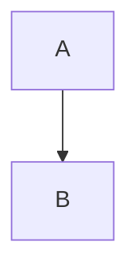

# Sample Document

Emoji :smile: and a checklist:

- [x] done
- [ ] todo

::: warning
Container text.
:::

Inline math $E = mc^2$ and block:

$$
\int_0^1 x^2 dx = \frac13
$$

```js
const x = 1;
```



## Repeat
## Repeat

<script>alert(1)</script>
<div class="page"/>

:[inc](included.md)

:[missing](nope.md)
